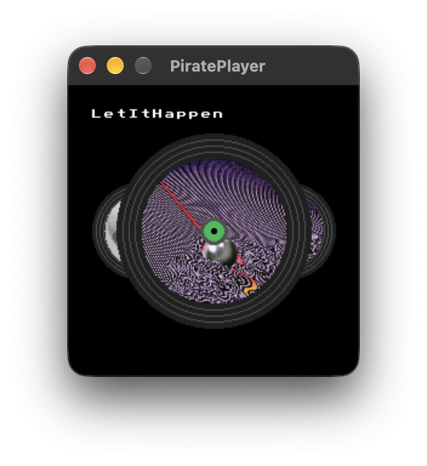

# PiratePlayer
A small music player window on your screen. 

Named after the 'Pimoroni Pirate Audio Hat' which is the goal for PiratePlayer to have support for.



## What is PiratePlayer

Pirate player is a music player interface that interracts with mpd. It plays local files in what ever format your music may be.

Supported audio formats:
- ".mp2"
- ".mp3"
- ".mp4"
- ".m4a"
- ".ogg"
- ".wav"
- ".flac"

> **NOTE**: m4a is the only tested format but the newest mpd version should handle all the listed formats.

## How to use PiratePlayer

**REQUIREMENTS**: 
- A system that either supports SDL applications (most systems).
- A system with a running instance of mpd. Ensure it is running with a appropriate config.

If the system meets the requirements the executable will run and start up the interface. If not working correctly try launching it from a terminal that can display the error messages.

The program also requires a argument which is the path to the directory containing the music. Currently it doesn't support directories inside that music directory, the music directory should only contain media files with a optional .png with the same extension. 

> **NOTE**: The display may appear pixelated. This is not a bug, the program is designed to later be ported to a 240x240 display hat.

**CONTROLS**:

Keyboard 'A' -- Scroll left

Keybard 'D' -- Scroll right

Keyboard SPACE -- Start file/Toggle playing

Keyboard BACKSPACE -- Go back/Refresh library

## How it works

At the depest level PiratePlayer uses its own framebuffer and graphics functions to write individual pixels to it. For playing the files all the actual audio is handled by mpd and PiratePlayer is just controlling mpd.

## Installation

### Option A: Download a prebuilt binary
If there is a binary for your system on the [Releases](https://github.com/WilGulf/PiratePlayer/releases) page, download it and then make it executable ('chmod +x pirate-player' on Linux/macOS). Then continue with setting up MPD.

### Option B: Build from source

#### 1. Install dependencies

PiratePlayer needs a C/C++ compiler, 'make', 'git', the SDL2 developent files, and 'libmpdclient'. You also need 'mpd' itself, which does the actual audio playback.

**Debian / Ubuntu / Raspberry Pi OS**
```sh
sudo apt update
sudo apt install git build-essential libsdl2-dev libmpdclient-dev mpd
```

**Fedora**
```sh
sudo dnf install git gcc gcc-c++ make SDL2-devel libmpdclient-devel mpd
```

**Arch / Manjaro**
```sh
sudo pacman -S git base-devel sdl2 libmpdclient mpd
```

**macOS** (requires [Homebrew](https://brew.sh))
```sh
xcode-select --install
brew install sdl2 libmpdclient mpd pkg-config
```

#### 2. Clone the source code
```sh
git clone https://github.com/WilGulf/PiratePlayer.git
cd PiratePlayer
```

#### 3. Check build config
The default `.config` is the only supported one, so you shouldn't need to change anything. Just confirm it contains:
```
DESKTOP_SDL=y
```

### 4. Compile
```sh
make
```

On success, the 'pirate-player' executable appears in the project folder.

### Set up mpd

PiratePlayer only *controls* mpd, so mpd must be running before you start it. And the config should point mpd to the directory containing your music.
  1. Config to place in '~/.config/mpd/mpd.conf', and remove the audio_output you don't need.
     ```
     music_directory "/path/to/music_directory"

     bind_to_address "127.0.0.1"
     port "6600"

     auto_update "yes"

     # macOS
     audio_output {
       type "osx"
       name "Mac CoreAudio"
       mixer_type "software"
     }

     # General Linux
     audio_output {
       type "pulse"
       name "Default"
     }
     ```
  2. Start mpd
     ```sh
     mpd
     ```
     Ensure it is running with this:
     ```sh
     mpc status
     ```

### Run
```sh
./pirate-player /path/to/music_directory
```
Use the same path you set as 'music_directory' in the mpd config.

## Acknowledgements
**Uses:**

- stb_image.h for png to pixel buffer. (http://nothings.org/stb)
- font8x8.h & font6x8.h as fonts. (https://github.com/idispatch/raster-fonts)
